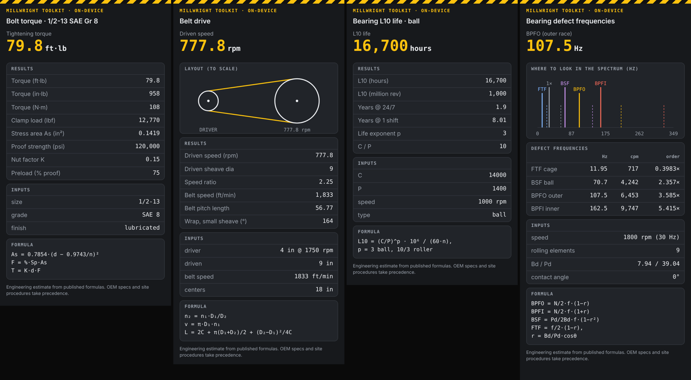

# Millwright Toolkit

An Agent Skill for [Google AI Edge Gallery](https://github.com/google-ai-edge/gallery) that turns an
on-device Gemma model into a shop-floor calculator. Ask in plain language, get the number, the
formula and the inputs on a card. Fully offline.



## Why it exists

Small on-device LLMs are good at understanding a request and bad at arithmetic. A wrong torque
value is a safety problem, not a typo. So the work is split:

| Layer | Does | Doesn't |
| :--- | :--- | :--- |
| LLM (Gemma, on device) | Picks the calculation, pulls parameters out of the sentence, asks for missing ones, explains the result | Compute anything |
| `scripts/calc.js` | All math, from published formulas and standards tables | Guess. Bad input throws a clear error |
| `assets/card.html` | Shows result, inputs, formula and warnings so a tech can check the work | Load anything from the network |

## What it calculates

| Action | Example prompt | Reference |
| :--- | :--- | :--- |
| `bolt_torque` | "Torque for 1/2-13 grade 8, oiled?" | T = K·d·F; stress area per ASME B1.1 / ISO 898-1; proof loads per SAE J429 / ISO 898-1 |
| `belt_drive` | "1750 rpm motor, 4 in sheave to 9 in, 18 in centers" | Speed ratio, belt speed, pitch length, wrap angle |
| `bearing_life` | "C 14 kN, load 1.4 kN, 1000 rpm, how many hours?" | ISO 281 basic rating life L10 |
| `bearing_faults` | "BPFO for a 6205 at 1800 rpm" | Standard BPFO / BPFI / BSF / FTF kinematics |

Built-in guardrails flag low sheave wrap, belt speed over its rating, preload above 90% of proof,
grades used outside their size range, and bearing loads where L10 isn't reliable.

## Run the tests

The math is unit-tested against published reference values: the 1/2-13 Gr 5 torque from the
standard SAE chart, the M10 stress area from ISO 898-1, and the SKF 6205 defect orders.

```bash
node --test skills/featured/millwright-toolkit/tests/calc.test.js
```

CI runs the same command on every change under `skills/` (`.github/workflows/skills-tests.yml`).

## Try it in the app

1. Merge to `main`. The existing Pages workflow (`.github/workflows/static.yml`) publishes `skills/`.
   In the repo settings, Pages → Source must be set to **GitHub Actions**.
2. In AI Edge Gallery, open **Agent Skills** → **Skills** → **(+)** → **Load skill from URL**:
   `https://mcmdmc.github.io/gallery/skills/featured/millwright-toolkit`
3. Or sideload it: `adb push skills/featured/millwright-toolkit /sdcard/Download/`, then use
   **Import local skill**.

## Disclaimer

The results are engineering estimates. Real nut factors vary by ±25% or more. OEM torque
specs and site procedures always take precedence.
